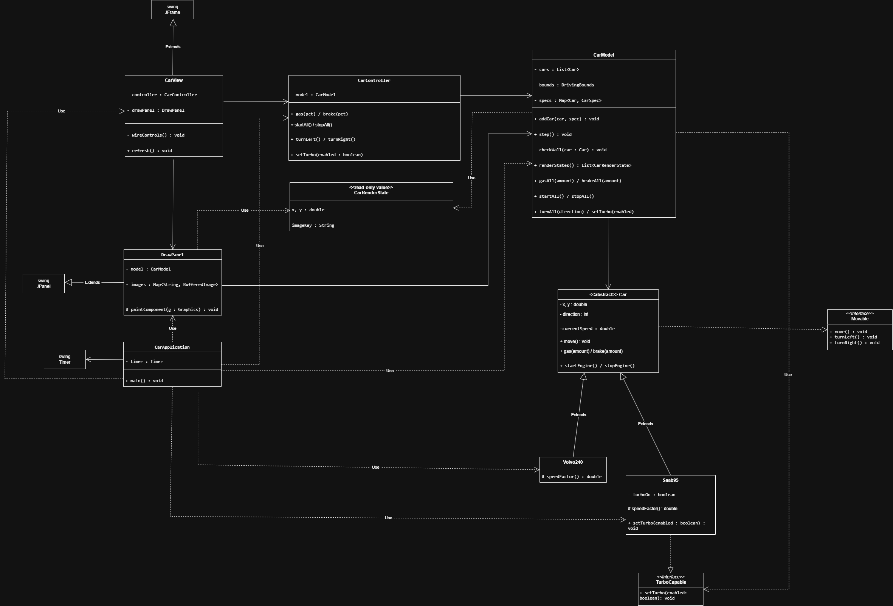

# Task 4 — Proposed design

[Task 2 — Current UML and dependencies](task2.md) · [Task 3 — Responsibilities and reasons to change](task3.md)

The proposed design gives the simulation rules to `CarModel`. The controller forwards user commands, the model updates the cars, and the view displays the result. This addresses the mix of responsibilities in `CarController` identified in Task 3 and the controller's dependencies on the view and concrete car types identified in Task 2.

## How the proposed simulator works

1. **Startup.** `CarApplication` creates the model, controller, view, drawing panel, and starter cars. It registers each car with a `CarSpec` containing its width, height, and image key. `DrivingBounds` supplies the size of the driving area. `CarApplication` also sets up the Swing timer.
2. **Button commands.** `CarView` forwards a button click to `CarController`. For Gas and Brake, the controller converts the percentage into the amount used by the model. `CarModel` applies the command to the cars it manages.
3. **Simulation and repaint.** On each timer tick, `CarApplication` calls `CarModel.step()` and then `CarView.refresh()`. The model moves each car and uses the driving bounds and that car's dimensions to check for a wall hit. On a hit, it stops, turns, and restarts that car. `Car` still handles an individual car's movement, direction, and speed.
4. **Drawing.** When Swing calls `paintComponent()`, `DrawPanel` reads `CarModel.renderStates()`. Each read-only `CarRenderState` gives the panel an `x`, a `y`, and an image key. The panel uses the key to find the picture in its image map and draws it at those coordinates. The solid arrow from `DrawPanel` to `CarModel` represents this read relationship. `CarApplication` drives `step()` through the timer.
5. **Turbo.** `CarModel` applies a turbo command to cars that implement `TurboCapable`. `Saab95` implements that interface and keeps its own turbo flag and acceleration behavior. `Volvo240` and `Saab95` still extend `Car`, which implements `Movable`.

## Why the design improves on Task 2

| Current design | Proposed design | Design principle |
| --- | --- | --- |
| `CarController` owns the list, handles input, runs the timer, checks walls, and updates the view. | The controller forwards commands, `CarModel` owns the simulation, and `CarApplication` schedules updates. | **Single responsibility and separation of concerns.** A change to the bounce rule belongs in the model. |
| `CarView` and `CarController` reference each other. The controller reaches through `frame.drawPanel.volvoImage` for the wall checks. | The view sends commands to the controller. The model receives bounds and dimensions as data. The panel reads position snapshots for drawing. | **Lower coupling and the Law of Demeter.** The collision code works with its own inputs and can be exercised without a Swing window. |
| The controller chooses between `moveVolvo()` and `moveSaab()`. The panel has separate positions for those two types. | The panel gets the same drawing information for every car. It looks up each image by key and uses one drawing loop. | **Open/closed principle.** A wider car can be registered with its own dimensions and image key. The same collision and drawing logic can handle it. |
| The controller checks specifically for `Saab95` when applying turbo. | The model applies turbo through `TurboCapable`. The actual car class supplies the behavior. | **Dependency inversion and interface segregation.** The turbo command depends on a small capability interface, and each car only needs to implement the capabilities it supports. |

The view still needs positions to draw the cars, and the application still needs to know which cars to create. Those dependencies have clear jobs. The design adds a few small types for the data passed between classes. `CarSpec` holds registration data, while `CarRenderState` holds the current drawing data. This keeps sprite size and position available where each is needed.

## Example to explain in the demo

Consider adding a Scania with a wider image. At startup, register its dimensions and the matching image key. When it moves toward the right wall, the model uses the Scania width to decide when to turn it around. The drawing panel looks up its image and draws it using the same loop as the Volvo and Saab. This shows how the redesign makes room for another car without adding a Scania branch to the controller or drawing panel.
